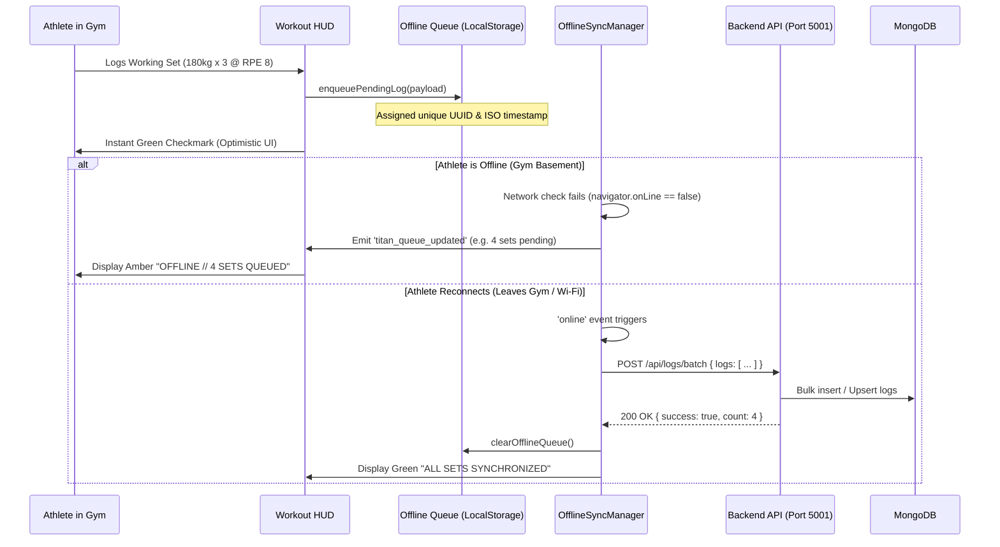

# TITAN-AI // 02. SYSTEM ARCHITECTURE & ENGINES

This document details the software architecture, component hierarchy, background micro-engines, and execution pipelines powering TITAN-AI.

---

## 1. Complete System Architecture Blueprint

```mermaid
flowchart TB
    subgraph Client [Client Application Tier - PWA]
        direction TB
        Browser[Modern Mobile / Desktop Browser]
        SW[Service Worker - Workbox Precache]
        
        subgraph UI [React 18 Frontend Layer]
            AppShell[TitanAppShell.jsx]
            Sidebar[ModernTitanSidebar.jsx - Collapsible Hierarchical]
            PlatformAdapter[usePlatform.js - iOS/Android Detection]
            GestureEngine[useNativeGestures.js - Popstate & Bezel Swipe]
            
            subgraph Views [Module Hubs]
                Dashboard[AthleteCommandCenter.jsx]
                WarRoom[MeetWarRoomHub.jsx]
                AILab[AILabHub.jsx]
                Hypertrophy[HypertrophyIntelligence.jsx]
                CVLab[ComputerVisionLab.jsx]
            end
        end

        subgraph ClientStorage [Client Persistence Layer]
            LocalStore[(LocalStorage: Auth, Realm, Settings)]
            OfflineDB[(IndexedDB / Offline Queue: Pending Logs)]
        end
    end

    subgraph Server [Backend Service Tier - Node.js Express Port 5001]
        direction TB
        ServerEntry[server.js - Middleware & Routing]
        
        subgraph Routes [REST API Handlers]
            R_Users[/api/users]
            R_Coach[/api/coach]
            R_Programs[/api/programs]
            R_Logs[/api/logs]
            R_Agents[/api/agents]
            R_AI[/api/ai]
            R_India[/api/india]
        end

        subgraph Engines [Autonomous Micro-Engines Layer]
            Engine_Evo[weeklyEvolutionEngine.js]
            Engine_Brain[aiProgramBrain.js]
            Engine_Council[recoveryCouncil.js]
            Engine_Attempt[competitionAttemptEngine.js]
            Engine_Scout[instagramScout.js]
            Engine_Liar[rpeLiarDetector.js]
        end
    end

    subgraph DataTier [Cloud & Local Data Tier]
        MongoDB[(MongoDB Atlas / Local)]
        Firebase[(Firebase Authentication)]
        LLM[Google Gemini 2.0 Flash / BYOK LLM]
    end

    %% Connections
    Browser --> AppShell
    AppShell --> PlatformAdapter
    AppShell --> GestureEngine
    AppShell --> Sidebar
    Sidebar --> Views
    
    Views <--> ClientStorage
    ClientStorage -->|Offline Flush on Reconnect| R_Logs
    Views -->|REST API Requests| Routes
    
    Routes --> Engines
    Engines --> MongoDB
    Routes --> Firebase
    Engine_Brain --> LLM
    Engine_Council --> LLM
```

---

## 2. Frontend Architecture (React 18 + Vite PWA)

### Core Technologies
- **Runtime & Bundler**: React 18.3 + Vite 5.4.
- **Styling Architecture**: Vanilla CSS + CSS Variables (`index.css`, `pwa-lock.css`, `modern-sidebar.css`). Zero Tailwind runtime bloat.
- **Icons**: Lucide React.
- **Animations & Gestures**: Framer Motion + Touch Event Listeners.
- **Offline & Service Worker**: `vite-plugin-pwa` with Workbox precaching of static assets and runtime caching of fonts and media.

### Key Layout Components
1. **`TitanAppShell.jsx`**: The root layout wrapper providing global reactive states, offline connectivity banners, quick world indicator, and PWA installation prompt mounting.
2. **`ModernTitanSidebar.jsx`**:
   - Replaced bloated, multi-row horizontal buttons with a **Linear/Stripe-style collapsible hierarchical drawer**.
   - Features expandable accordions:
     - **Daily Essentials**: Active Workout, Movement Library, Nutrition Architect, Athlete Profile.
     - **Platform & Meet War Room**: Meet Prep Scout, 9-for-9 Attempt Selector, Olympic Plate Loader, Warmup Matrix, Weigh-in & Water Cut, Record Proximity, RPE Liar Detector, Technical Rulebook.
     - **AI Performance Lab**: Autonomous Weekly Evolution, Computer Vision Biomechanics, Recovery Council, AI Coach Conversation.
   - Built-in live search filter to jump directly to any of the 12+ modules in 1 click.
3. **`InstallPrompt.jsx`**:
   - Platform-aware smart PWA install banner.
   - Automatically detects standalone display mode (`window.matchMedia('(display-mode: standalone)').matches`) and stays hidden if already installed.
   - Implements a **7-day dismissal cooldown** (`localStorage.setItem('titan_pwa_install_dismissed')`) to prevent nagging users.
   - On iOS Safari: Displays visual 2-step prompt ("Tap Share -> Add to Home Screen").
   - On Android Chrome: Intercepts `beforeinstallprompt` for a native 1-tap install.

---

## 3. Platform Adaptability & Native "App-Lock" Engine

To make the Progressive Web App indistinguishable from an iOS Swift or Android Kotlin native application, TITAN-AI implements three platform-adaptive layers:

### 1. The "App-Lock" CSS Architecture (`pwa-lock.css`)
- **Safe Area Insets**: Full support for iPhone Dynamic Island, camera notches, and Android navigation gesture pills via `env(safe-area-inset-top)` and `env(safe-area-inset-bottom)`.
- **Zero Overscroll Rubber-Banding**: `overscroll-behavior: none` on `html` and `body` stops destructive pull-to-refresh reloads during workouts.
- **Global Text-Selection Lock**: `user-select: none` across all cards, buttons, and HUD elements stops accidental blue text selection while tapping fast.
  - *Exception*: Form inputs, textareas, and `.selectable-text` maintain `user-select: auto` so lifters can paste numbers or notes freely.
- **Elimination of Tap Highlight Overlays**: `-webkit-tap-highlight-color: transparent` removes the ugly default grey mobile browser box.

### 2. Platform Detection Hook (`usePlatform.js`)
- Dynamically parses `navigator.userAgent` and platform capabilities to set root classes:
  - `.platform-ios`: Activates San Francisco font stack (`-apple-system`, `SF Pro Display`) and blur glassmorphism.
  - `.platform-android`: Activates Roboto font stack and Material Design elevation shadows.
  - `.display-standalone`: Hides install buttons when running in fullscreen standalone window.
- Provides `hapticTap()`: Triggers `navigator.vibrate(12)` on Android devices for crisp tactile feedback when toggling sets or checkboxes.

### 3. Native Gesture Interception (`useNativeGestures.js`)
- **Android Back-Button Trap (`useAndroidBackInterceptor`)**:
  - Pushes a dummy state into HTML5 `history.pushState`.
  - When the athlete swipes the Android back gesture or presses the system hardware back button, TITAN-AI intercepts `popstate` to close open modals, drawers, or return to the main dashboard rather than exiting the browser.
- **iOS Left-Bezel Edge Swipe (`useIOSEdgeSwipeBack`)**:
  - Listens to `touchstart` coordinates `< 32px` from the left screen bezel.
  - Tracks swipe velocity and displacement; triggers a native-feeling smooth back navigation when displacement exceeds 80px.

---

## 4. Backend Architecture (Node.js + Express Port 5001)

The backend server (`backend/server.js`) operates as a lightweight, event-driven REST API listening on **Port 5001**:

### Route Architecture
- `/api/users`: Athlete authentication, profile data, biometrics, training maxes.
- `/api/coach`: Program generation, coach feedback, workout notes.
- `/api/logs`: Session set logging, historical volume queries, and `/batch` endpoint for offline sync.
- `/api/programs`: Active mesocycle structure, microcycle days, exercise substitutions.
- `/api/progress`: e1RM progression curves, tonnage trends, bodyweight tracking.
- `/api/agents`: Multi-agent subsystem execution (Recovery Council, Sentiment Engine, Vision).
- `/api/titan-os`: System diagnostics, engine health checks, telemetry status.
- `/api/india`: Indian Powerlifting federation standards, state meet schedules, Desi nutritional tables.

---

## 5. Autonomous Micro-Engines Deep Dive

### Engine 1: Weekly Micro-Cycle Evolution (`weeklyEvolutionEngine.js`)
- **Input**: Completed 7-day training telemetry (average RPE on top sets, missed reps count, CNS fatigue score 0-100, scale weight shift in kg, athlete-reported joint pain).
- **Algorithmic Rules**:
  - `avgRpe <= 7.5 && missedReps === 0 && fatigueScore < 45`: Initiates **Progressive Overload** (+2.5kg to +5.0kg on primary compound lifts).
  - `avgRpe >= 9.2 || missedReps > 0 || fatigueScore > 65`: Triggers **Fatigue Autoregulation** (0kg load increase; reduces working set volume by 10% to prevent overreaching).
  - `7.6 <= avgRpe <= 9.1`: Applies standard steady micro-overload (+1.25kg to +2.5kg).
  - **Joint Prehab Detection**: If shoulder pain is reported, automatically swaps Flat Barbell Bench to 30° Incline Dumbbell Bench (neutral grip). If elbow pain is reported, swaps skull crushers to cable pushdowns.
  - **Weight Shift Sync**: If scale weight drops > 0.6kg, recommends +150 kcal surplus; if scale rises > 0.6kg, trims 100 kcal of fats.
- **Output**: Fully re-synthesized 7-day program schedule with updated loads and coach rationale debrief.

### Engine 2: Biomechanics Computer Vision Pipeline (`cvEngine.js` & MediaPipe Pose)
- **Execution**: 100% client-side via WebGL. No video is ever transmitted over the network.
- **Joint Tracking**: Tracks 33 body landmarks (shoulders, elbows, wrists, hips, knees, ankles, heels, toes).
- **Key Metrics Derived**:
  1. **Mean Concentric Velocity (MCV)**: Real-time bar displacement over time (m/s).
  2. **Velocity Loss Percentage**: Evaluates fatigue accumulation across a set.
  3. **Squat Depth Geometry**: Computes the 2D plane angle between hip joint landmark and knee joint landmark; verifies hip crease drops below the top of the patella.
  4. **Bar Path Horizontal Deviation**: Calculates horizontal distance from the barbell vertical line to the mid-foot landmark to detect mechanical power leakage.

### Engine 3: Social-Scout & Meet Intelligence (`instagramScout.js`)
- **Capabilities**:
  - Crawls public powerlifting federation tags (#USAPL, #PowerliftingIndia, #IPF) for sanctioned meet announcements.
  - OCR extraction of meet flyers: parses meet date, venue location, registration deadline, and entry fee.
  - **Community Crowdsource Sync**: Enables local lifters to submit their local state or district meets. Once verified, the meet syncs to all lifters within a 300km radius.
  - **Podium & Record Proximity**: Compares athlete's current training total against official state/national records in their weight class.

### Engine 4: RPE Liar & Bar Velocity Detector (`rpeLiarDetector.js`)
- Solves the classic powerlifting problem where athletes overestimate or underestimate their exertion.
- **Logic**:
  - If athlete logs `RPE 9.5` (supposedly 0-1 rep in reserve), but Mean Concentric Velocity was `> 0.35 m/s`:
    - System flags: *"RPE OVERSHOOT REPORTED // True velocity indicates RPE 7.5. Psychological fatigue or self-doubt detected."*
  - If athlete logs `RPE 7` (3 reps in reserve), but bar velocity ground down to `< 0.15 m/s`:
    - System flags: *"EGO UNDER-REPORTING // Bar velocity was near terminal threshold. Injury risk high. Reduce next set load by 5%."*

### Engine 5: Recovery Council Multi-Agent System (`recoveryCouncil.js`)
- Tri-agent autonomous advisory council:
  1. **Nutrition Agent**: Analyzes protein intake vs lean body mass; flags protein deficits.
  2. **Sleep Agent**: Evaluates REM/deep sleep and circadian consistency.
  3. **Head Coach Agent**: Synthesizes inputs from the other two agents to make real-time volume and intensity adjustments before the athlete touches the barbell.

---

## 6. Gym Basement Offline-First Synchronization Architecture

TITAN-AI uses an offline-first architecture via `offlineSyncManager.js`:



---

## 7. Enterprise Security Architecture & Anti-Hacking Defenses

To prevent brute-force attacks, unauthorized penetration, parameter tampering, and denial-of-service attempts, TITAN-AI implements an enterprise-grade defense-in-depth model:

| Layer | Threat Mitigated | Defensive Implementation |
| :--- | :--- | :--- |
| **HTTP Security Headers** | Clickjacking, MIME-sniffing, XSS, Protocol Downgrade | `helmet`: Injects `HSTS` (31536000s), `X-Frame-Options: SAMEORIGIN`, `X-Content-Type-Options: nosniff`, and strips `X-Powered-By`. |
| **Two-Tier Rate Limiting** | Brute-force credential cracking, AI quota drainage, DDoS | `express-rate-limit`: Tier 1 (1200 req/15min for general telemetry), Tier 2 (Strict 50 req/15min on `/login`, `/register`, and `/ai`). |
| **Anti-Injection Sanitizer** | NoSQL `$gt`/`$ne` operator injection, Prototype Pollution | Custom recursive scanner strips any keys beginning with `$` or matching `__proto__` / `constructor`. |
| **Payload Size Capping** | Server RAM exhaustion & JSON Buffer Flooding (DoS) | Strict body limit of `2mb` across `express.json()` and `express.urlencoded()`. |
| **Origin Whitelisting** | Cross-Origin Data Theft & CSRF Exploits | `cors`: Dynamically validates request origins against whitelist with credential protection. |
| **Exception Shield** | Server file path, database credential, or stack trace leaks | Centralized security error handler obfuscates raw internal errors from client responses in production. |
| **Zero-Trust Video Processing** | Athlete Gym Privacy & Video Surveillance Leaks | MediaPipe WebGL computes pose coordinates entirely inside device RAM. Video files are never uploaded to the cloud. |

